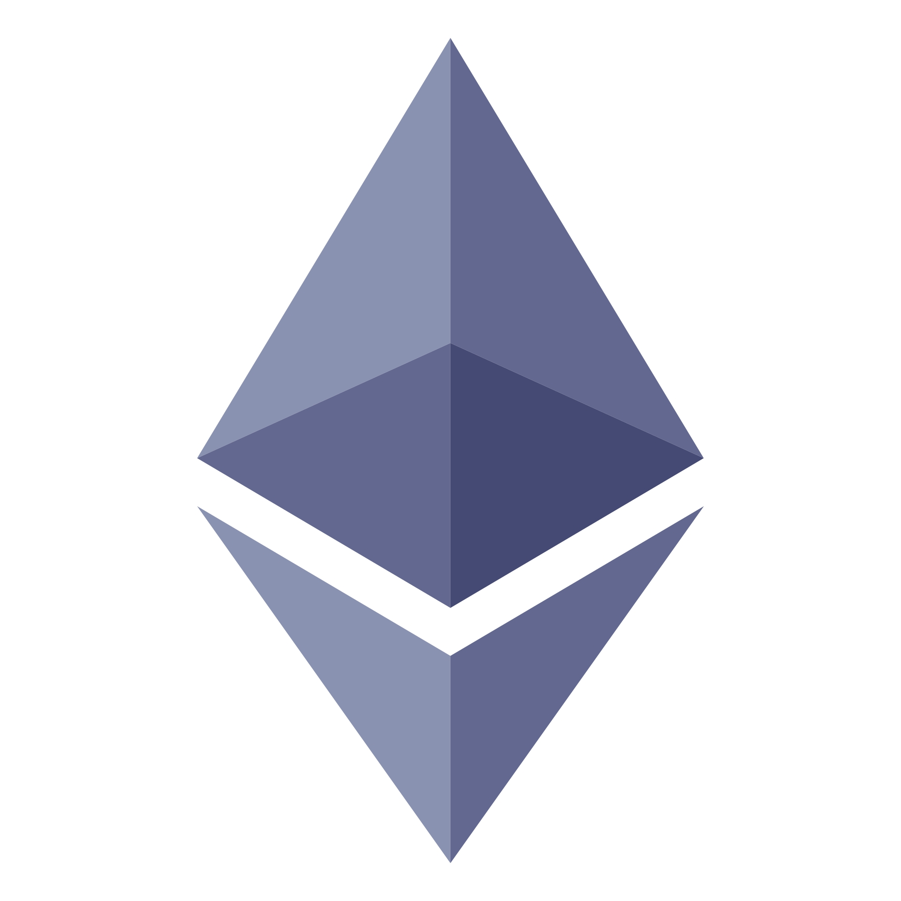

# chainsim

Local mainnet forks in Docker, with a JSON CLI built for scripts and AI agents.

[](https://github.com/MatrixLabsTech/chainsim/actions/workflows/ci.yml)
[](https://github.com/MatrixLabsTech/chainsim/releases)
[](LICENSE)

chainsim starts a private copy of a real chain that reads live mainnet state on demand, so tests
can use real contracts, pools and tokens with test wallets and no real money. Each chain family
needs a different engine with its own flags, readiness signal and funding method. chainsim puts
them behind one CLI, so `up`, `fund`, `snapshot`, `revert`, `send` and `down` work the same way
on every supported chain.

<p align="center">
  <a href="chains/ethereum/README.md"></a>
  &nbsp;&nbsp;&nbsp;
  <a href="chains/arc/README.md"></a>
  &nbsp;&nbsp;&nbsp;
  <a href="chains/robinhood/README.md"></a>
  &nbsp;&nbsp;&nbsp;
  <a href="chains/sui/README.md"></a>
</p>

## What it solves

- Every chain family forks with a different engine: anvil for Ethereum and Arbitrum chains,
  Circle's arc-foundry tarballs for Arc, Mysten's gRPC-only `sui-fork` for Sui. Each has its own
  flags, readiness signal and funding method. chainsim pins each engine, pulls or builds it on
  first use, and puts all of them behind the same commands.
- Testing admin-only paths of a deployed protocol normally needs keys nobody on the test team
  holds. `send --as` sends as the admin on the fork, and `set` changes state directly.
- Funding a test wallet with real tokens on a fork means finding each token's balance slot or
  owned coins. `fund` and `set` do it per chain and read the result back.
- A fork differs from mainnet in ways that are easy to miss. Each chain's `limits` list those
  differences in plain sentences for a test report, and `selftest` checks a fork before a test
  relies on it.
- Fork tools print logs written for people. chainsim prints one JSON object per command with a
  fixed exit code and the next command to run, so a script or an AI agent can act on it.
- Public RPC endpoints rate-limit and keep only recent state, and the failures are hard to
  read. chainsim reports them as upstream errors that name the variable to set and say when an
  archive node is needed.

## Features

- One CLI for Ethereum, Arc, Robinhood Chain and Sui mainnet forks, each running in Docker.
- One-line install from GitHub releases for Linux and macOS, and `chainsim doctor` to check the
  setup: Docker, engines, plugin and upstreams.
- `send --as` acts as any account without its key, including a protocol's admin.
- `set` overrides state directly: balance, token, storage, code or owner, as each chain supports.
- `fund` gives a test wallet native and token balances and reads them back.
- `snapshot` and `revert` reset a fork between scenarios.
- `selftest` proves a fork is fit before a test spends anything on it.
- Arc runs on Circle's own engine, so native USDC behaves as on Arc.
- Robinhood Chain answers Arbitrum's ArbSys and ArbGasInfo precompiles.
- JSON output, fixed exit codes and `error.next`, so an agent can branch on every result.
- A Claude Code and Codex plugin, installed straight from GitHub, teaches agents the setup and
  the workflow.
- Forks publish no host ports by default, and provider keys never appear in output.

## Install

chainsim needs Docker. Install the latest release on Linux (x86_64 or arm64) or macOS (Apple
silicon):

```sh
curl -fsSL https://raw.githubusercontent.com/MatrixLabsTech/chainsim/main/install.sh | sh
chainsim doctor
```

The script checks the archive's SHA-256 and copies `chainsim` to `~/.local/bin`. Pass
`sh -s -- --version v0.1.0` for a given version. `chainsim doctor` reports Docker, the engine
images, the plugin and each chain's upstream variable.

From source, with Rust 1.88 or later:

```sh
git clone https://github.com/MatrixLabsTech/chainsim
cd chainsim
cargo install --locked --path crates/chainsim
```

## Quick start

Fork Ethereum mainnet, fund a test wallet, pause USDC as its pauser without the pauser's key,
and clean up:

```sh
chainsim up ethereum-mainnet
chainsim selftest ethereum-mainnet
chainsim fund ethereum-mainnet 0xd8d244aF69B839999883F9f32a68C7F184012e8a --native 10 --token USDC:1000
chainsim send ethereum-mainnet --as 0x4914f61d25e5c567143774b76edbf4d5109a8566 \
  --to 0xA0b86991c6218b36c1d19D4a2e9Eb0cE3606eB48 --sig "pause()"
chainsim status ethereum-mainnet
chainsim down ethereum-mainnet
```

`up` prints the `fork` object with the in-network `rpcUrl` and the chain's `limits`. A fork is
reachable from containers on its Docker network. From the host, use `chainsim call`, or start
the fork with `--publish`.

## Built for agents

- Every command prints one JSON object on stdout, even on error. Logs go to stderr.
- Exit codes are fixed, so an agent branches on the code: 0 ok, 1 error, 2 usage, 3 unsupported,
  4 not found, 5 upstream failure, 6 selftest failed, 7 refused for safety, 8 conflict.
- On failure, `error.next` is the next command to run:

  ```console
  $ chainsim status demo | jq -r '.error.code, .error.next'
  fork_not_found
  chainsim ls
  ```

- `up`, `down` and `fund` are safe to repeat: a running fork is returned as is, a missing fork
  is already down, and `fund` sets balances to the asked amounts.
- `describe` and the `fork` object carry each chain's `limits`, plain sentences an agent copies
  into its report.
- `selftest` exits 0 only when every check passes, with each check's cause in `data`.
- `status` lists every `send` and `set` under `modifications`, so a report can say which
  results depend on a change mainnet would not allow.
- The Claude Code and Codex plugin adds a skill that starts with a setup check through
  `chainsim doctor`, then walks through up, selftest, fund, snapshot and revert, and cleanup.
- Codex's default sandbox blocks the Docker socket, so in Codex chainsim runs outside it after
  an escalation.

The full contract, with every error code, is in [docs/agent-contract.md](docs/agent-contract.md).

## Supported chains

| Chain | Maturity | Engine | Details |
| --- | --- | --- | --- |
|  &nbsp;**Ethereum mainnet** | stable | Foundry anvil v1.8.5 | [chains/ethereum](chains/ethereum/README.md) |
|  &nbsp;**Arc mainnet** | stable | Circle arc-foundry v0.8.0-2 | [chains/arc](chains/arc/README.md) |
|  &nbsp;**Robinhood Chain mainnet** | stable | Foundry anvil v1.8.5 with an ArbGasInfo mock | [chains/robinhood](chains/robinhood/README.md) |
|  &nbsp;**Sui mainnet** | experimental | Mysten sui-fork, mainnet-v1.81.1 | [chains/sui](chains/sui/README.md) |

The chain logos are trademarks of their owners and identify the chains only.

Each chain page says what is specific to it: engine, tokens, funding, `send` and `set` support,
selftest checks and limits. `chainsim describe` prints the same list from the binary.

## Claude Code and Codex plugin

Install the plugin from GitHub. In Claude Code:

```sh
claude plugin marketplace add MatrixLabsTech/chainsim
claude plugin install chainsim@chainsim
```

In Codex:

```sh
codex plugin marketplace add MatrixLabsTech/chainsim
codex plugin add chainsim@chainsim
```

Offline, `chainsim install` adds the copy of the plugin built into the binary to each CLI found
on `PATH`, and prints a suggested Claude Code permission rule.

## DeepQA

<a href="https://deepqa.app">
  <picture>
    <source media="(prefers-color-scheme: dark)" srcset="assets/deepqa-logo-dark.svg">
    
  </picture>
</a>

chainsim is built as the chain engine for [DeepQA](https://deepqa.app), MatrixLabs' agentic QA
workflow for dApps, and MatrixLabs maintains it. DeepQA is moving its on-chain test runs onto
chainsim forks. On Arc, the native USDC that chainsim's engine runs lets DeepQA's runner drop
the testing-only USDC stand-in and balance-sync process it uses today.

## Documentation

- [docs/architecture.md](docs/architecture.md): engines, the control sidecar, networks,
  `--publish`, the engine lock, upstreams and profiles.
- [docs/agent-contract.md](docs/agent-contract.md): commands, the JSON envelope and every exit
  and error code.
- [docs/adding-a-chain.md](docs/adding-a-chain.md): a new profile, or a new chain family.
- [docs/security.md](docs/security.md): replay risk, impersonation, provider keys and container
  isolation.

## Contributing

Issues and pull requests are welcome. `cargo test --workspace` runs the unit and contract
tests. The acceptance tests start real forks, need Docker and network access, and are marked
`#[ignore]`: run them with `cargo test --workspace -- --ignored --test-threads=1`.

## License

Apache-2.0. See [LICENSE](LICENSE). The engine images chainsim pulls or builds keep their own
licenses.
